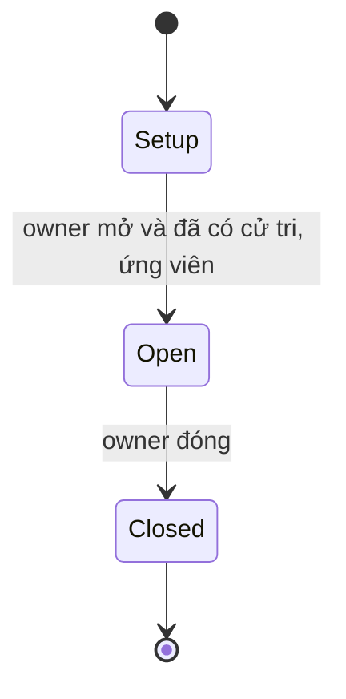

# Thiết kế và giao diện hợp đồng Election

Tài liệu bàn giao từ Thành viên 1 cho Thành viên 2. Bản này mô tả chế độ bỏ phiếu công khai trong `contracts/Election.sol`.

## Vòng đời và phân quyền

Một lần triển khai tạo một cuộc bầu cử. Tài khoản triển khai trở thành `owner` cố định. Chỉ `owner` đăng ký cử tri, thêm ứng viên, mở và đóng. `vote` dựa trên `msg.sender`, nên admin cũng phải được đăng ký nếu muốn bỏ phiếu. Khi mở, danh sách ứng viên và cử tri được khóa. Khi đóng, các giá trị đã chốt vẫn được đọc công khai.

## Giao diện cho FE và BE

Hardhat sinh `deployments/local.json` sau xác nhận triển khai. Backend lấy `rpcUrl`, `chainId`, `address` và `abi`. Dùng ABI dạng mảng JSON từ bản deploy hiện tại. Chữ ký hàm, kiểu trả về và các enum đã được cố định cho tích hợp trong bảng dưới đây.

| Hàm | Kết quả hoặc điều kiện |
| --- | --- |
| `owner()` | `address` của admin. |
| `phase()` | `uint8` với `0 = Setup`, `1 = Open`, `2 = Closed`. |
| `eligibleVoterCount()` | `uint256` đếm tất cả địa chỉ đăng ký, kể cả các địa chỉ đã bỏ phiếu. |
| `voterStatus(address)` | `uint8` với `0 = Unregistered`, `1 = Eligible`, `2 = Voted`. |
| `candidateCount()` | `uint256` cho tổng số ứng viên. Mã ứng viên từ `0` đến `count - 1`. |
| `getCandidate(uint256)` | Hai giá trị riêng theo thứ tự `string name`, `uint256 voteCount`. Mã ngoài phạm vi trả lỗi `InvalidCandidate`. |
| `registerVoter(address)` | Admin, `Setup`. Từ chối địa chỉ zero hoặc đăng ký trùng. |
| `addCandidate(string)` | Admin, `Setup`. Từ chối tên rỗng. Có thể phân biệt ứng viên trùng tên bằng mã. |
| `openVoting()` | Admin, `Setup`. Cần ít nhất một cử tri và một ứng viên. |
| `vote(uint256)` | `Open`, địa chỉ đủ điều kiện, chưa bỏ phiếu và mã ứng viên hợp lệ. |
| `closeVoting()` | Admin, `Open`. Chuyển sang `Closed` vĩnh viễn. |

Các sự kiện tương ứng là `VoterRegistered(address)`, `CandidateAdded(uint256,string)`, `VotingOpened()`, `VoteCast(address,uint256)` và `VotingClosed()`. Lỗi quyền, giai đoạn, địa chỉ và mã ứng viên được biểu diễn bằng custom errors có trong ABI. Xem [kết quả test](ket-qua-kiem-thu.md) để đối chiếu hành vi revert.

### Bản triển khai bàn giao trên Ganache Desktop

| Thông tin | Giá trị |
| --- | --- |
| RPC và Chain ID | `http://127.0.0.1:7545`, `1337` |
| Địa chỉ `Election` | `0xB83Cc84EDEc54C915Ae71024729893142C6037c8` |
| Địa chỉ admin test | `0x195Cab71A742e0Bb60a756cDa133767Cf95E1073` |
| Giao dịch deploy | `0x22ca055f31aa856015c6c6ddc3b2ef83dee2a281978d31a0c9c9f47a70b59210` |
| Trạng thái khi deploy | `Setup`, 0 cử tri, 0 ứng viên |

Địa chỉ trên thuộc workspace dùng lúc bàn giao. Khi đổi workspace hoặc muốn tạo cuộc bầu cử khác, chạy `npm.cmd run deploy:ganache` và dùng địa chỉ mới trong `deployments/local.json`.

## Bảo mật và giới hạn

- Phân quyền và quy tắc bỏ phiếu nằm trong hợp đồng, nên vẫn áp dụng khi người dùng gọi trực tiếp. Một giao dịch thành công cập nhật trạng thái `Voted` và bộ đếm trong cùng giao dịch. Luồng bỏ phiếu không gọi sang hợp đồng bên ngoài.
- Một địa chỉ đủ điều kiện có tối đa một phiếu. Danh sách người thật và quan hệ giữa người với ví do ban tổ chức xác minh trước khi đăng ký. Admin nắm quyền chọn thời điểm mở và đóng.
- Địa chỉ người gửi và mã ứng viên xuất hiện trong giao dịch hoặc sự kiện. Quyền đọc công khai cũng có nghĩa lá phiếu công khai có thể truy ngược theo địa chỉ.
- `mapping(address => VoterStatus)` tra trực tiếp trạng thái và tái sử dụng ô lưu trữ đã có khi chuyển `Eligible → Voted`. Đọc bảng [đo gas](ket-qua-do-gas.md) để xem kết quả so với hai mapping riêng.
