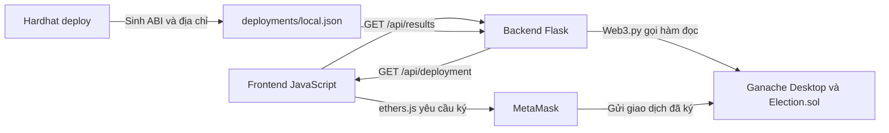

# Triển khai frontend và backend cho đồ án bầu cử

**Phiên bản 1.0 · 17/11/2026**

Đọc cùng [tài liệu yêu cầu](yeu-cau.md) và [hướng dẫn triển khai hợp đồng](trien-khai.md). Tài liệu này đặc tả mã cần viết và các bước nghiệm thu cho chế độ bỏ phiếu công khai. Hợp đồng mẫu có `store()` và `retrieve()` chỉ minh họa cách kết nối Web3.py. Trong đồ án, dùng ABI và địa chỉ của `Election.sol`.

## 1. Kiến trúc và trách nhiệm

| Thành phần | Công nghệ | Trách nhiệm |
| --- | --- | --- |
| Frontend | HTML, CSS, JavaScript thuần, Vite, ethers.js 6 | Hiển thị ứng viên và kết quả từ API. Kết nối MetaMask, chuẩn bị giao dịch và cập nhật giao diện sau xác nhận. |
| Backend | Python 3.11, Flask, Web3.py | Đọc thông tin cuộc bầu cử từ Ganache, chuẩn hóa dữ liệu và trả JSON cho trang web. |
| Hợp đồng | Solidity 0.8.24 trên Ganache Desktop | Kiểm tra admin, giai đoạn và tư cách cử tri. Ghi nhận phiếu và lưu số phiếu trên chuỗi. |



Flask cung cấp API đọc. MetaMask giữ khóa của người dùng và ký các giao dịch ghi trong trình duyệt. Backend không cần tài khoản Ganache hoặc khóa ví. Dữ liệu bầu cử lấy từ hợp đồng, vì vậy bản demo không cần cơ sở dữ liệu riêng.

## 2. Vị trí hợp đồng, frontend, backend và cấu hình dùng chung

Xem [cây thư mục đầy đủ của repository](trien-khai.md#2-cấu-trúc-đầy-đủ-của-repository) để đối chiếu mã nguồn, cấu hình, kiểm thử và tài liệu bàn giao. Các đường dẫn dưới đây tính từ thư mục gốc `Blockchain_project/`.

| Đường dẫn | Vai trò trong luồng triển khai |
| --- | --- |
| `contracts/Election.sol` | Hợp đồng Solidity. Mở tệp này trong Remix IDE để biên dịch và thử tương tác. Hardhat triển khai cùng mã nguồn lên Ganache Desktop. |
| `scripts/deploy.ts` | Triển khai `Election.sol` bằng Hardhat và xuất `deployments/local.json`. |
| `deployments/local.json` | Tệp sinh sau deploy. Chứa RPC, Chain ID, địa chỉ hợp đồng và ABI để Flask kết nối đúng bản triển khai. |
| `backend/election_client.py` và `backend/app.py` | Web3.py đọc hợp đồng. Flask trả kết quả và thông tin deployment qua API. |
| `frontend/src/api.js` và `frontend/src/wallet.js` | JavaScript gọi API Flask và dùng ABI cùng địa chỉ từ API để gửi giao dịch qua ethers.js và MetaMask. |
| `test/Election.ts` và `scripts/measure-gas.ts` | Chạy kiểm thử hợp đồng bằng Hardhat và đo gas trên Ganache. |

Sau khi deploy và có biên nhận thành công, script Hardhat ghi `rpcUrl`, `chainId`, `address`, `abi` vào `deployments/local.json`. Dùng RPC và Chain ID thực tế của workspace, địa chỉ hợp đồng mới deploy và ABI từ artifact `Election`. ABI lưu dưới dạng mảng JSON. Khóa ví và mnemonic nằm ngoài tệp này. Cấu hình mẫu dưới đây chỉ minh họa cấu trúc. 

```json
{
  "rpcUrl": "http://127.0.0.1:7545",
  "chainId": 1337,
  "address": "<dia-chi-Election-sau-khi-deploy>",
  "abi": []
}
```

Flask đọc tệp từ đường dẫn tính theo thư mục repository. Frontend nhận cùng `address`, `chainId` và `abi` qua API, nên cả hai phần cùng trỏ tới một bản triển khai. Sau khi deploy lại hoặc đổi workspace, khởi động lại Flask và tải lại trang. [Khởi tạo hợp đồng bằng địa chỉ và ABI trong Web3.py](https://web3py.readthedocs.io/en/stable/web3.contract.html)

## 3. Backend Python và Web3.py

### 3.1 Kết nối với Ganache

1. Đọc và kiểm tra `deployments/local.json`. Báo lỗi cấu hình nếu thiếu tệp, ABI rỗng, địa chỉ sai hoặc Chain ID không hợp lệ.
2. Khởi tạo một `Web3.HTTPProvider(rpc_url, request_kwargs={"timeout": 5})` cho tiến trình Flask. Kiểm tra RPC có phản hồi, `w3.eth.chain_id` khớp `chainId` và `w3.eth.get_code(address)` trả bytecode. Chuẩn hóa địa chỉ bằng `Web3.to_checksum_address`. Kiểm tra bytecode xác nhận có hợp đồng tại địa chỉ. Đọc thử `owner()` và `phase()` để phát hiện lỗi ABI thường gặp.
3. Tạo đối tượng `w3.eth.contract(address=address, abi=abi)`. Gọi `.call()` cho các hàm đọc. Trong mỗi yêu cầu kết quả, lấy số block một lần và truyền `block_identifier` đó cho `owner()`, `phase()`, `candidateCount()`, `getCandidate(id)` và `voterStatus(address)`. Cùng số block giúp tránh việc danh sách ứng viên và số phiếu đến từ các thời điểm khác nhau.
4. Đưa dữ liệu vào JSON có tên trường rõ ràng. Ánh xạ `phase` từ enum Solidity thành `Setup`, `Open` hoặc `Closed` và `voterStatus` thành `Unregistered`, `Eligible` hoặc `Voted`. Trả số phiếu dưới dạng chuỗi thập phân để JavaScript giữ chính xác giá trị `uint256`.

Ví dụ phần truy vấn sau khi đã kết nối hợp lệ. `getCandidate(id)` trả hai trường theo thứ tự `name`, `voteCount`.

```python
block_number = w3.eth.block_number
candidate_count = contract.functions.candidateCount().call(
    block_identifier=block_number
)
candidates = []
for candidate_id in range(candidate_count):
    name, vote_count = contract.functions.getCandidate(candidate_id).call(
        block_identifier=block_number
    )
    candidates.append({"id": candidate_id, "name": name, "votes": str(vote_count)})
```

### 3.2 Giao ước API

| Endpoint | Phản hồi thành công | Cách dùng |
| --- | --- | --- |
| `GET /api/health` | `status`, `chainId`, `address` | Kiểm tra Flask truy cập được Ganache và bản triển khai theo cấu hình. |
| `GET /api/deployment` | `chainId`, `address`, `abi` | Frontend lấy cấu hình để tạo đối tượng hợp đồng ethers.js. |
| `GET /api/results` | `blockNumber`, `owner`, `phase`, `candidates`, `voterStatus` | Trang công khai gọi API này khi mở và định kỳ. `voterStatus` là `null` nếu chưa gửi địa chỉ. |
| `GET /api/results?voter=0x...` | Cùng cấu trúc với `voterStatus` của địa chỉ yêu cầu | Cập nhật nút bỏ phiếu sau khi kết nối hoặc đổi tài khoản. Trạng thái trả về chỉ phục vụ hiển thị, quyền thực tế do hợp đồng kiểm tra khi gửi giao dịch. |

Ví dụ phản hồi của `/api/results` khi chưa kết nối ví. Địa chỉ dưới đây chỉ là giá trị minh họa.

```json
{
  "blockNumber": 12,
  "owner": "0x0000000000000000000000000000000000000001",
  "phase": "Open",
  "candidates": [
    { "id": 0, "name": "An", "votes": "2" },
    { "id": 1, "name": "Bình", "votes": "1" }
  ],
  "voterStatus": null
}
```

| HTTP | Tình huống | Xử lý |
| --- | --- | --- |
| `400` | Tham số `voter` sai định dạng | Trả `{"error":{"code":"INVALID_VOTER","message":"Địa chỉ cử tri không hợp lệ"}}`. |
| `503` | RPC ngừng phản hồi, sai Chain ID hoặc chưa có hợp đồng đúng cấu hình | Trả lỗi có mã như `GANACHE_UNAVAILABLE`, `CHAIN_MISMATCH` hoặc `DEPLOYMENT_UNAVAILABLE`. Ghi chi tiết vào log Flask. |
| `502` | Ganache phản hồi nhưng lời gọi đọc hoặc giải mã thất bại | Trả `CONTRACT_READ_FAILED`. Kiểm tra ABI, địa chỉ và bản triển khai trong log. |

Trả `Cache-Control: no-store` cho kết quả và cấu hình deployment local. Giao diện có thể giữ kết quả đã tải trong bộ nhớ và đánh dấu là dữ liệu cũ khi mất kết nối. [Flask Quickstart](https://flask.palletsprojects.com/en/stable/quickstart/)

## 4. Frontend JavaScript và MetaMask

### 4.1 Giao diện và quyền thao tác

| Màn hình | Dữ liệu và thao tác |
| --- | --- |
| Kết quả công khai | Hiện giai đoạn, ứng viên, số phiếu và block cập nhật gần nhất. Trạng thái ban đầu là đang tải. API lỗi thì báo tình trạng kết nối, giữ số liệu lần đọc thành công và đánh dấu dữ liệu cũ. |
| Ví | Nút **Kết nối MetaMask**, địa chỉ đang dùng và tình trạng đúng hoặc sai mạng. Mở kết nối ví sau thao tác của người dùng. |
| Admin | Địa chỉ ví phải khớp `owner`. Trong `Setup`, hiện form đăng ký cử tri, thêm ứng viên và nút mở. Trong `Open`, hiện nút đóng. |
| Cử tri | Trong `Open`, chỉ bật nút bỏ phiếu khi mạng đúng, địa chỉ có trạng thái `Eligible` và đã chọn một ứng viên. Hiển thị rõ `Unregistered` hoặc `Voted` khi tương ứng. |

Dùng `textContent` khi đưa tên ứng viên hoặc thông báo API lên trang. Dữ liệu từ hợp đồng là nội dung hiển thị. Khi chưa có MetaMask, trang vẫn tải được kết quả và hiển thị chỉ dẫn tại khu vực cần ký.

### 4.2 Luồng xem và gửi giao dịch

1. Khi tải trang, gọi `/api/results` để hiện dữ liệu công khai. Gọi lại khoảng 3 giây sau khi yêu cầu trước hoàn tất. Giữ một yêu cầu làm mới tại một thời điểm và tải lại ngay sau xác nhận giao dịch.
2. Khi bấm **Kết nối MetaMask**, dùng `new BrowserProvider(window.ethereum)` và yêu cầu quyền truy cập tài khoản. So sánh Chain ID của `provider.getNetwork()` với `chainId` của `/api/deployment`. Hướng dẫn chuyển sang mạng Ganache đã cấu hình nếu sai mạng.
3. Trước khi ghi, xác nhận mạng đúng, có bytecode ở địa chỉ deployment và tài khoản hiện tại khớp phiên thao tác. Tạo `new Contract(address, abi, signer)`. Gọi đúng hàm của hợp đồng, chẳng hạn `vote(candidateId)`, rồi chờ `tx.wait()` để lấy biên nhận. [Kết nối ví và gọi hợp đồng trong ethers.js](https://docs.ethers.org/v6/getting-started/)
4. Trong lúc chờ, khóa nút gửi và hiển thị trạng thái chờ ký hoặc chờ xác nhận. Khi có biên nhận thành công, hiển thị mã giao dịch và tải lại kết quả từ API. Khi người dùng từ chối ký hoặc hợp đồng revert, hiện lý do phù hợp và tải lại trạng thái trước lần thử tiếp theo.
5. Khi có `accountsChanged` hoặc `chainChanged`, xóa quyền hiển thị và lựa chọn phụ thuộc phiên cũ, đọc lại mạng và dữ liệu cử tri. Nếu ví ngắt kết nối, trở về chế độ xem công khai. Các giới hạn trên giao diện giúp tránh thao tác nhầm, còn Solidity kiểm tra quyền và chống bỏ phiếu trùng khi giao dịch thực thi.

Ví dụ hàm gửi phiếu trong `wallet.js`. `deployment` là JSON đã tải thành công từ `/api/deployment`. Gọi hàm sau khi người dùng đã kết nối ví và bấm bỏ phiếu.

```javascript
import { BrowserProvider, Contract } from "ethers";

export async function submitVote(deployment, candidateId, activeAccount) {
  const provider = new BrowserProvider(window.ethereum);
  const network = await provider.getNetwork();
  if (network.chainId !== BigInt(deployment.chainId)) {
    throw new Error("Hãy chuyển MetaMask sang mạng Ganache của đồ án.");
  }
  if ((await provider.getCode(deployment.address)) === "0x") {
    throw new Error("Chưa tìm thấy hợp đồng tại địa chỉ đã triển khai.");
  }
  const signer = await provider.getSigner();
  if ((await signer.getAddress()).toLowerCase() !== activeAccount.toLowerCase()) {
    throw new Error("Tài khoản đã đổi. Hãy kiểm tra lại ví trước khi bỏ phiếu.");
  }
  const election = new Contract(deployment.address, deployment.abi, signer);
  const transaction = await election.vote(candidateId);
  return await transaction.wait();
}
```

## 5. Cài đặt và chạy local trên Windows

Các lệnh dưới đây dùng sau khi nhóm đã tạo mã và tệp cấu hình tương ứng. Chạy từ thư mục gốc của repository. Máy hiện có Python `3.11.7`. Ghi phiên bản Flask và Web3.py đã kiểm thử vào `backend/requirements.txt`, cùng các phiên bản npm trong `package-lock.json`.

### 5.1 Ganache và bản triển khai

Mở Ethereum workspace của Ganache Desktop. Kiểm tra RPC và Chain ID thực tế theo [hướng dẫn triển khai hợp đồng](trien-khai.md). Chạy các lệnh sau và kiểm tra `deployments/local.json` có địa chỉ mới và ABI hợp lệ.

```powershell
npm.cmd ci
npx.cmd hardhat run scripts/deploy.ts --network ganache
```

### 5.2 Backend

```powershell
python -m venv .venv
.\.venv\Scripts\python.exe -m pip install -r backend/requirements.txt
.\.venv\Scripts\python.exe -m flask --app backend.app run --host 127.0.0.1 --port 5000
```

Giữ terminal Flask đang chạy. Kiểm tra hai URL từ terminal khác.

```powershell
Invoke-RestMethod http://127.0.0.1:5000/api/health
Invoke-RestMethod http://127.0.0.1:5000/api/results
```

### 5.3 Frontend

Đặt proxy của Vite trong `frontend/vite.config.js` để frontend gọi `fetch("/api/results")` qua cùng địa chỉ web. Vite chuyển tiếp `/api` sang Flask trên port `5000`. [Cấu hình proxy Vite](https://vite.dev/config/server-options.html#server-proxy)

```javascript
import { defineConfig } from "vite";

export default defineConfig({
  server: {
    host: "127.0.0.1",
    port: 5173,
    strictPort: true,
    proxy: { "/api": "http://127.0.0.1:5000" },
  },
});
```

Trong một terminal riêng chạy `npx.cmd vite frontend`, sau đó mở `http://127.0.0.1:5173`. Mở MetaMask ở cùng trình duyệt và chọn đúng RPC của Ganache, nhập các tài khoản test cần dùng rồi kết nối từ trang web. Cả Ganache, Flask và Vite chạy trên cùng máy trong demo.

## 6. Kiểm tra tích hợp và xử lý lỗi

| Ca kiểm tra | Kết quả mong đợi |
| --- | --- |
| Mở trang khi chưa kết nối MetaMask | Danh sách và số phiếu hiển thị từ Flask. |
| Kết nối ví admin, thêm dữ liệu và mở bầu cử | Giao dịch được ký từ ví admin. API đọc lại đúng giai đoạn `Open` và danh sách mới. |
| Đổi sang cử tri đủ điều kiện và bỏ phiếu | Số phiếu tăng một lần sau xác nhận. Trạng thái chuyển sang `Voted` và cập nhật cả ở cửa sổ xem công khai. |
| Thử địa chỉ chưa đăng ký hoặc bỏ phiếu lần hai | Giao diện phản ánh trạng thái cử tri. Test Hardhat gọi trực tiếp để xác nhận hợp đồng revert. |
| Hủy ký hoặc chuyển ví sang mạng khác | Giao diện báo nguyên nhân, giữ kết quả công khai và chỉ cho thao tác ghi khi ví đúng mạng. |
| Tắt Ganache hoặc trỏ Flask vào địa chỉ cũ | API báo lỗi và trang đánh dấu dữ liệu đã cũ. Khởi động lại đúng workspace hoặc deploy lại và tải lại cấu hình để phục hồi. |
| Admin đóng bầu cử | API trả `Closed`, các nút bỏ phiếu bị khóa và kết quả vẫn đọc được. |

Nếu `/api/health` trên port `5000` chạy nhưng `/api/results` qua port `5173` không chạy, kiểm tra Vite có nạp `frontend/vite.config.js` và proxy đúng port. Nếu trang thấy đúng Chain ID nhưng gửi giao dịch tới sai workspace, đối chiếu cả URL RPC của MetaMask và địa chỉ hợp đồng hiện trên trang với tệp deployment. Chain ID có thể trùng giữa hai workspace local.
