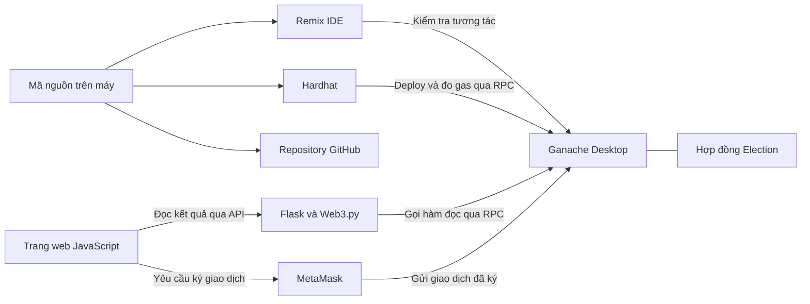
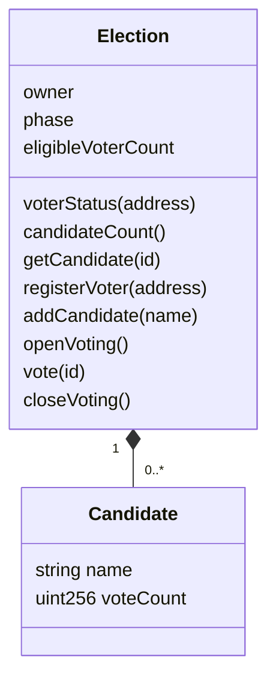

# Tài liệu thiết kế và triển khai đồ án bầu cử

**Phiên bản 1.3 · 17/11/2026**  
Tài liệu này hướng dẫn xây dựng và nghiệm thu các yêu cầu trong [tài liệu yêu cầu](yeu-cau.md). Xem [hướng dẫn frontend và backend](trien-khai-fe-be.md) để triển khai API và giao diện. Các lệnh test, deploy và đo gas giả định nhóm đã tạo các tệp tương ứng ở mục 2.

## 1. Môi trường và kiến trúc

| Thành phần | Cấu hình và vai trò |
| --- | --- |
| Windows, thư mục dự án | Viết và lưu Solidity, test và mã web trên máy. Có thể sửa mã bằng VS Code. Chạy các lệnh dự án trong PowerShell. |
| Remix IDE | Mở mã Solidity từ thư mục dự án, biên dịch và kiểm tra tương tác hợp đồng. Remix Desktop có thể mở trực tiếp thư mục local. Với Remix trên trình duyệt, nhập các tệp Solidity vào workspace. [Remix Desktop](https://remix-ide.readthedocs.io/en/latest/desktop.html) · [File Explorer](https://remix-ide.readthedocs.io/en/latest/file_explorer.html) |
| Node.js và npm | Máy đồ án đã có Node.js `24.14.1` và npm `11.11.0`. Hardhat 3 yêu cầu Node.js từ `22.13.0`. [Yêu cầu Hardhat](https://hardhat.org/docs/getting-started) |
| Hardhat 3 | Chạy test tự động với Mocha và ethers.js, triển khai bản dùng cho web lên Ganache và chạy script đo gas. Ghi phiên bản thực tế vào README và commit `package-lock.json`. [Toolbox Mocha và ethers.js](https://hardhat.org/docs/plugins/hardhat-toolbox-mocha-ethers) |
| Solidity | `0.8.24`, `evmVersion: "paris"`, optimizer bật với `runs: 200`. Dùng cùng cấu hình cho deploy và đo gas. [Cấu hình trình biên dịch](https://hardhat.org/docs/reference/configuration) |
| Ganache Desktop | Dùng bản `2.7.1` và tạo Ethereum workspace mới trên Windows. RPC dự kiến `http://127.0.0.1:7545`, bật Automine. [Bản phát hành](https://github.com/ConsenSys-archive/ganache-ui/releases/tag/v2.7.1) · [Cấu hình mặc định](https://archive.trufflesuite.com/docs/ganache/reference/workspace-default-configuration/) |
| Frontend | JavaScript thuần (`.js`), HTML, CSS và Vite. Gọi API Flask để đọc kết quả và dùng ethers.js 6 với `BrowserProvider` để gửi giao dịch qua MetaMask. [Tài liệu ethers.js](https://docs.ethers.org/v6/single-page/) |
| Backend | Python, Flask và Web3.py. Đọc ABI, địa chỉ và cấu hình mạng từ tệp deployment, truy vấn Ganache và trả kết quả qua API JSON. |
| MetaMask | Admin và cử tri dùng ví để ký giao dịch từ trang web. Người xem đọc kết quả qua API công khai. Script deploy dùng tài khoản test trên Ganache. |



## 2. Cấu trúc đầy đủ của repository

Cây dưới đây mô tả repository khi đồ án hoàn thành. Hợp đồng Solidity nằm tại `contracts/Election.sol`. Ba thư mục `contracts/`, `backend/` và `frontend/` cùng nằm ở gốc dự án. Hiện các tệp đã có nằm trong `docs/`.

```text
Blockchain_project/
├── contracts/
│   └── Election.sol              # hợp đồng Solidity mở trong Remix IDE
├── test/
│   └── Election.ts               # kiểm thử hợp đồng bằng Hardhat
├── scripts/
│   ├── deploy.ts                 # deploy Election lên Ganache, xuất cấu hình
│   └── measure-gas.ts            # đo gas từ biên nhận trên Ganache
├── deployments/
│   └── local.json                 # Hardhat sinh sau deploy, chứa RPC, Chain ID, địa chỉ, ABI
├── backend/
│   ├── __init__.py
│   ├── app.py                    # API và xử lý lỗi HTTP bằng Flask
│   ├── election_client.py        # đọc hợp đồng qua Web3.py
│   └── requirements.txt         # thư viện Python
├── frontend/
│   ├── index.html
│   ├── vite.config.js            # chuyển yêu cầu /api sang Flask
│   └── src/
│       ├── main.js               # giao diện và trạng thái
│       ├── api.js                # gọi API Flask
│       ├── wallet.js             # ethers.js và MetaMask
│       └── styles.css
├── docs/
│   ├── yeu-cau.md
│   ├── trien-khai.md
│   ├── trien-khai-fe-be.md
│   ├── phan-cong-cong-viec.md     # đầu việc, người phụ trách và mốc bàn giao
│   ├── ket-qua-kiem-thu.md       # kết quả Hardhat và kiểm tra tích hợp
│   ├── ket-qua-do-gas.md         # số liệu Ganache và so sánh tối ưu
│   ├── bao-cao.pdf               # báo cáo nộp 4–6 trang
│   └── kich-ban-demo.md           # kịch bản demo 10 phút
├── hardhat.config.ts
├── tsconfig.json                 # cấu hình TypeScript cho công cụ và kiểm thử
├── package.json
├── package-lock.json
├── .gitignore
└── README.md
```

`contracts/Election.sol` là mã nguồn dùng chung cho Remix và Hardhat. Khi triển khai thành công, `scripts/deploy.ts` ghi `deployments/local.json`. Flask đọc tệp này, trả kết quả qua `/api/results` và cung cấp địa chỉ cùng ABI cho frontend qua `/api/deployment`. Frontend dùng hai giá trị đó khi tạo giao dịch bằng MetaMask. Tệp `local.json` được tạo riêng cho từng workspace Ganache và đưa vào `.gitignore`.

## 3. Thiết kế hợp đồng `Election`



| Thành phần | Thiết kế |
| --- | --- |
| `owner` | `address immutable` gán từ `msg.sender` khi deploy. Dùng `onlyOwner` cho đăng ký cử tri, thêm ứng viên, mở và đóng. |
| `phase` | Enum `Setup`, `Open`, `Closed`. Dùng kiểm tra giai đoạn trong hợp đồng. |
| `voterStatus` | `mapping(address => VoterStatus)` với `Unregistered`, `Eligible` và `Voted`. Đăng ký chuyển `Unregistered` sang `Eligible`. Bỏ phiếu thành công chuyển `Eligible` sang `Voted`. |
| `eligibleVoterCount` | Tăng mỗi khi đăng ký thành công để xác minh có ít nhất một cử tri trước khi mở. Giá trị biểu thị tổng số địa chỉ đã được đăng ký. |
| `candidates` | Mảng `Candidate`. Chỉ số mảng là mã ứng viên. Đọc qua `candidateCount()` và `getCandidate(id)`. |

`vote(id)` kiểm tra `Open`, trạng thái cử tri và phạm vi mã ứng viên. Sau đó cập nhật trạng thái cử tri, tăng bộ đếm ứng viên và phát `VoteCast`. Không có lời gọi sang hợp đồng bên ngoài trong luồng bỏ phiếu. Dùng lỗi Solidity có tên để test có thể xác minh nguyên nhân revert, chẳng hạn `Unauthorized`, `WrongPhase`, `NotRegistered`, `AlreadyVoted` và `InvalidCandidate`.

| Hàm ghi | Sự kiện sau khi thành công |
| --- | --- |
| `registerVoter(voter)` | `VoterRegistered(voter)` |
| `addCandidate(name)` | `CandidateAdded(candidateId, name)` |
| `openVoting()` | `VotingOpened()` |
| `vote(candidateId)` | `VoteCast(voter, candidateId)` |
| `closeVoting()` | `VotingClosed()` |

Nếu làm phần mở rộng, có thể triển khai hợp đồng riêng với hai thao tác `commitVote` và `revealVote`. Dùng `keccak256(abi.encode(block.chainid, address(this), voter, candidateId, salt))` để ràng buộc cam kết với mạng, hợp đồng và cử tri. Web sinh `bytes32 salt` bằng nguồn ngẫu nhiên mật mã và cho cử tri lưu dữ liệu reveal riêng. Thêm sự kiện cho mở/đóng từng giai đoạn, cam kết và công bố. Khi tính gas, báo cáo cả hai giao dịch và tổng chi phí của một phiếu đã công bố.

## 4. Thiết lập và chạy

### 4.1 Tạo workspace Ganache

Mở Ganache Desktop, tạo Ethereum workspace `Club Election`, bật Automine và ghi lại địa chỉ RPC hiển thị trong ứng dụng. Kiểm tra Chain ID thực tế bằng PowerShell. Nếu workspace dùng port khác, sửa URI trong lệnh dưới đây.

```powershell
$ganacheRpc = 'http://127.0.0.1:7545'
$chainResponse = Invoke-RestMethod -Method Post -Uri $ganacheRpc `
  -ContentType 'application/json' `
  -Body '{"jsonrpc":"2.0","method":"eth_chainId","params":[],"id":1}'
[Convert]::ToInt32($chainResponse.result.Substring(2), 16)
```

Kết quả `0x539` trong RPC tương ứng với Chain ID `1337`. Giá trị `5777` thường thấy trong cài đặt Ganache Desktop là Network ID. Dùng số do `eth_chainId` trả về khi khai báo mạng trong Hardhat, cấu hình web và MetaMask. [Hướng dẫn Ganache và MetaMask](https://archive.trufflesuite.com/guides/nft-marketplace/)

### 4.2 Mở mã nguồn và thử hợp đồng trong Remix IDE

1. Lưu hợp đồng trong `contracts/Election.sol` trên máy. Nếu dùng **Remix Desktop**, mở thư mục dự án từ ứng dụng để làm việc trực tiếp với cùng mã nguồn. Nếu dùng **Remix trên trình duyệt**, đưa các tệp `.sol` vào **File Explorer**. Giữ cấu trúc thư mục nếu có `import` và nạp lại tệp sau mỗi lần sửa trên máy. [Mở tệp local trong Remix](https://remix-ide.readthedocs.io/en/latest/import.html) · [File Explorer](https://remix-ide.readthedocs.io/en/latest/file_explorer.html)
2. Trong **Solidity Compiler**, chọn `0.8.24`. Mở **Advanced Compiler Configurations**, chọn EVM `paris`, bật **Enable optimization** và đặt `200` runs. Mở `Election.sol`, bấm **Compile** và xem ABI tại **Compilation Details**. [Cấu hình Solidity Compiler](https://remix-ide.readthedocs.io/en/latest/compile.html)
3. Để thử trên **Ganache Desktop**, mở **Deploy & Run Transactions**. Trong **Environment**, chọn **External HTTP Provider** và nhập RPC của workspace. Nếu Remix web không kết nối trực tiếp được với RPC, dùng **Browser Extension**, chọn MetaMask đã kết nối đúng mạng Ganache theo mục 4.5. Chọn hợp đồng `Election`, chọn tài khoản test admin và bấm **Deploy**. Dùng **Deployed Contracts** để thử đăng ký cử tri, thêm ứng viên và gọi `owner()` hoặc `getCandidate(id)`. [Deploy & Run trong Remix](https://remix-ide.readthedocs.io/en/latest/run.html)
4. Ghi địa chỉ hoặc mã giao dịch nếu cần đối chiếu bản thử trong Ganache. Sau khi deploy bằng Hardhat ở mục 4.4, Flask đọc địa chỉ và ABI do script Hardhat xuất rồi cung cấp cho trang web qua API. Mỗi lần deploy tạo một cuộc bầu cử riêng với địa chỉ riêng.

### 4.3 Khởi tạo Hardhat cho bản nộp

Chạy `npx.cmd hardhat@3 --init` từ thư mục gốc và chọn mẫu TypeScript dùng Mocha và ethers.js. Thêm Vite vào dự án bằng `npm.cmd install --save-dev vite` và thêm ethers.js 6 làm phụ thuộc trực tiếp bằng `npm.cmd install ethers@6`. Người nhận repository đã có lockfile dùng `npm.cmd ci`. Sau khi thay mã ví dụ bằng mã đồ án, dùng cấu hình sau cho `hardhat.config.ts`.

TypeScript dùng cho cấu hình Hardhat, kiểm thử và các script triển khai hoặc đo gas. Mã nguồn frontend nằm trong `frontend/` và dùng JavaScript thuần.

```ts
import { defineConfig } from "hardhat/config";
import hardhatToolboxMochaEthers from "@nomicfoundation/hardhat-toolbox-mocha-ethers";

export default defineConfig({
  plugins: [hardhatToolboxMochaEthers],
  solidity: {
    version: "0.8.24",
    settings: {
      evmVersion: "paris",
      optimizer: { enabled: true, runs: 200 },
    },
  },
  networks: {
    ganache: {
      type: "http",
      url: "http://127.0.0.1:7545",
      chainId: 1337,
      accounts: "remote",
    },
  },
});
```

`accounts: "remote"` cho phép script dùng tài khoản test Ganache đã mở khóa. RPC nên chỉ lắng nghe trên `127.0.0.1`. Dùng thiết lập `paris` để giới hạn bytecode ở tập lệnh tương thích với Ganache Desktop 2.7.1. [Cấu hình mạng Hardhat](https://hardhat.org/docs/reference/configuration) · [Cấu hình EVM của Solidity](https://docs.soliditylang.org/en/v0.8.24/using-the-compiler.html#setting-the-evm-version-to-target)

### 4.4 Kiểm thử, deploy và mở web

```powershell
npx.cmd hardhat build
npx.cmd hardhat test
npx.cmd hardhat run scripts/deploy.ts --network ganache
```

Test tự động mặc định chạy trên mạng mô phỏng của Hardhat để dễ tạo trạng thái độc lập cho từng ca. Script deploy lấy tài khoản test đầu tiên, triển khai `Election`, chờ xác nhận rồi ghi `address`, `chainId`, `rpcUrl` và `abi` vào `deployments/local.json`. Chạy Flask và Vite theo mục 5 của [hướng dẫn frontend và backend](trien-khai-fe-be.md). Nếu tạo lại blockchain hoặc đổi workspace, triển khai lại, khởi động lại Flask và tải lại trang để dùng cấu hình mới.

### 4.5 Kết nối MetaMask và chạy thử từ web

1. Trong MetaMask, chọn **Manage networks → Add a custom network**. Nhập tên `Ganache Local`, đúng RPC, đúng Chain ID và ký hiệu `ETH`. [Hướng dẫn MetaMask](https://support.metamask.io/configure/networks/how-to-add-a-custom-network-rpc)
2. Nhập khóa riêng của tài khoản **test** Ganache dùng làm admin và hai tài khoản cử tri. Đối chiếu địa chỉ admin với `owner()` của hợp đồng. Giữ khóa test ngoài mã nguồn và chỉ sử dụng trên mạng local.
3. Mở URL mà Vite in ra. Dùng tài khoản admin để thêm hai ứng viên, đăng ký hai cử tri và mở bầu cử. Đổi sang tài khoản cử tri và ký giao dịch bỏ phiếu. Mở trang trong phiên chưa kết nối ví để xác nhận số phiếu hiển thị công khai.
4. Giao diện cần xử lý `accountsChanged`, `chainChanged`, người dùng từ chối ký và lỗi giao dịch. Dùng `receipt` hoặc block mới để cập nhật lại từ hợp đồng. Nếu ví báo sai mạng, kiểm tra Chain ID và URL của workspace. Nếu trang báo chưa có hợp đồng, kiểm tra Ganache đang chạy và deploy lại đúng workspace.

### 4.6 Đẩy mã nguồn từ máy lên GitHub

Khi mã chạy được, tạo repository GitHub và dùng Git từ thư mục dự án trên máy. Thêm vào `.gitignore` các thư mục sinh trong quá trình chạy như `node_modules/`, `artifacts/`, `cache/`, `.venv/` và `__pycache__/`, cùng tệp `.env`, tệp deploy local `deployments/local.json` và các tệp chứa khóa ví hoặc mnemonic. Giữ `package-lock.json` và `backend/requirements.txt`. Cập nhật README với lệnh cài đặt, cấu hình Remix, cách chạy Hardhat, Flask và Vite.

Với repository mới trên máy và một repository GitHub trống, chạy các lệnh sau. Thay `URL_REPOSITORY` bằng địa chỉ repository của nhóm. Kiểm tra danh sách tệp được thêm trước khi commit.

```powershell
git init -b main
git add .
git diff --cached --name-only
git commit -m "Hoan thien do an bau cu blockchain"
git remote add origin URL_REPOSITORY
git push -u origin main
```

Với repository đã có `origin`, dùng remote và nhánh hiện có. Sau khi push, kiểm tra trên GitHub rằng README, hợp đồng, test, script và tài liệu đều có mặt.

## 5. Kiểm thử, gas và nghiệm thu

| Nhóm test | Dữ liệu cần xác nhận |
| --- | --- |
| Quy trình thành công | Tài khoản deploy là admin, đăng ký và thêm ứng viên phát sự kiện, mở/đóng đúng giai đoạn, hai cử tri bỏ phiếu và lượt phiếu cập nhật đúng ứng viên. |
| Phân quyền và cấu hình | Người thường gọi hàm admin, địa chỉ zero, đăng ký trùng, tên ứng viên rỗng, mở khi thiếu dữ liệu hoặc sửa danh sách sau khi mở đều revert. |
| Bỏ phiếu | Chưa đăng ký, lần hai, mã không hợp lệ, trước khi mở và sau khi đóng đều revert. Kiểm tra trạng thái cử tri và số phiếu sau giao dịch bị từ chối. |
| Tích hợp Ganache | Deploy thành công, web đọc được khi chưa kết nối ví, admin và cử tri ký bằng MetaMask, kết quả đổi sau xác nhận và giữ nguyên sau khi đóng. |

Chạy `npx.cmd hardhat run scripts/measure-gas.ts --network ganache` sau khi triển khai script đo. Mỗi lượt đo dùng hợp đồng mới để không thay đổi cuộc bầu cử demo. Lấy `gasUsed` từ biên nhận thành công và ghi kèm tên hàm, cấu hình biên dịch, phiên bản Ganache và giao dịch. Đo theo thứ tự deploy, đăng ký cử tri, thêm ứng viên, mở, phiếu đầu cho một ứng viên, phiếu tiếp theo cho cùng ứng viên và đóng. Khi so sánh chi phí thêm ứng viên, dùng tên có cùng độ dài. Các lời gọi đọc qua `eth_call` không phát sinh phí giao dịch cho người xem.

**Tối ưu dự kiến.** Dùng một `mapping(address => VoterStatus)` để tra trạng thái trực tiếp và tái sử dụng ô lưu trữ của địa chỉ đã đăng ký khi bỏ phiếu. Để định lượng, so với bản đối chứng dùng hai mapping riêng cho `eligible` và `hasVoted`, dưới cùng compiler, optimizer, sự kiện, dữ liệu đầu vào và trạng thái ban đầu. Báo cáo số gas đo được và chênh lệch của `registerVoter` và `vote`. Chưa có số liệu khi chưa chạy script trên Ganache.

| Thời lượng demo | Thao tác |
| --- | --- |
| 0–2 phút | Mở Ganache, deploy bằng Hardhat và kiểm tra mạng của MetaMask. |
| 2–4 phút | Với vai trò admin, đăng ký hai cử tri, thêm hai ứng viên và mở bầu cử. |
| 4–7 phút | Đổi ví, ký phiếu và xem kết quả cập nhật từ trang công khai. |
| 7–9 phút | Minh họa bỏ phiếu lần hai bị từ chối, có thể dùng kết quả test tái lập nếu web đã ẩn nút. Đóng bầu cử và kiểm tra kết quả cuối. |
| 9–10 phút | Trình bày số ca test và bảng gas. Nếu có commit–reveal, chỉ ra thời điểm lá phiếu được công bố. |

Báo cáo 4–6 trang sẽ dùng sơ đồ và thiết kế ở trên, bổ sung kết quả test và gas thực tế, phân tích quyền admin, dữ liệu phiếu công khai và giới hạn của commit–reveal nếu thực hiện.

## 6. Phân công cho hai người

Thành viên 1 phụ trách hợp đồng, Hardhat, Ganache và đo gas. Thành viên 2 phụ trách backend, frontend và kiểm thử tích hợp. Xem [tài liệu phân công công việc](phan-cong-cong-viec.md) để theo dõi đầu ra, tiêu chí hoàn thành, mốc bàn giao và phần demo của mỗi thành viên.
