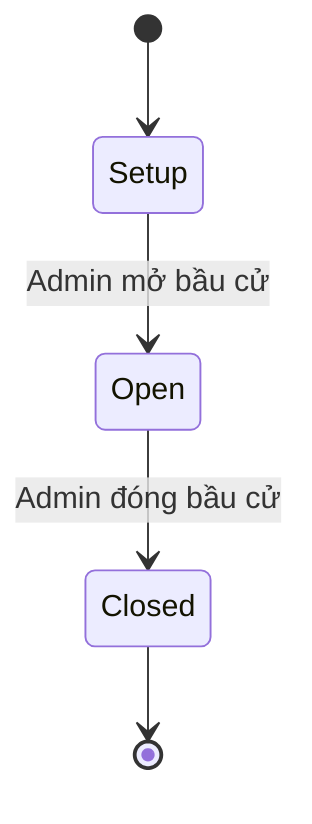

# Tài liệu yêu cầu đồ án bầu cử trên blockchain

**Phiên bản 1.3 · 17/11/2026**  
**Phạm vi** — Bầu cử lớp hoặc câu lạc bộ trên mạng Ethereum cục bộ.

## 1. Mục tiêu và phạm vi

Ban tổ chức lập danh sách địa chỉ ví đủ điều kiện, đăng ký ứng viên và điều hành một cuộc bầu cử. Cử tri đủ điều kiện chọn một ứng viên và gửi tối đa một phiếu hợp lệ từ địa chỉ đã đăng ký. Kết quả được tính trong hợp đồng và hiển thị công khai sau khi giao dịch được xác nhận.

Mỗi bản triển khai của hợp đồng đại diện cho một cuộc bầu cử. Muốn tổ chức cuộc khác, triển khai một hợp đồng mới. Ban tổ chức đối chiếu danh sách người thật và địa chỉ ví bên ngoài hệ thống. Blockchain thực thi quy tắc một phiếu trên mỗi địa chỉ đủ điều kiện.

### Vai trò

| Vai trò | Quyền và trách nhiệm |
| --- | --- |
| Admin | Tài khoản triển khai hợp đồng. Đăng ký cử tri, thêm ứng viên, mở và đóng cuộc bầu cử. Muốn bỏ phiếu, admin cũng phải đăng ký địa chỉ của mình trước khi mở. |
| Cử tri | Kết nối MetaMask bằng địa chỉ đã đăng ký, chọn ứng viên và ký giao dịch bỏ phiếu. |
| Người xem | Xem giai đoạn cuộc bầu cử, danh sách ứng viên và số phiếu từ trang web mà không cần kết nối ví. |

## 2. Vòng đời cuộc bầu cử

| Giai đoạn | Quy tắc |
| --- | --- |
| `Setup` | Admin đăng ký cử tri và ứng viên. Phải có ít nhất một cử tri và một ứng viên trước khi mở. |
| `Open` | Danh sách cử tri và ứng viên đã được khóa. Hợp đồng nhận phiếu và cập nhật số phiếu theo ứng viên. |
| `Closed` | Kết quả được chốt và vẫn đọc được. Cuộc bầu cử chỉ đi theo một chiều từ `Setup` đến `Closed`. |

## 3. Yêu cầu chức năng bắt buộc

| Mã | Yêu cầu | Tiêu chí nghiệm thu |
| --- | --- | --- |
| F01 | Đăng ký cử tri | Admin thêm một địa chỉ ví trong `Setup`. Địa chỉ zero, địa chỉ đã đăng ký và yêu cầu của tài khoản thường đều bị từ chối. |
| F02 | Đăng ký ứng viên | Admin thêm ứng viên có tên khác chuỗi rỗng trong `Setup`. Hợp đồng cấp mã số riêng, bắt đầu từ `0`. Giao diện hiển thị cả tên và mã để phân biệt tên trùng. |
| F03 | Mở bầu cử | Admin chuyển từ `Setup` sang `Open` khi đã có cử tri và ứng viên. Việc thêm cử tri, thêm ứng viên và gọi mở lại sau đó đều bị từ chối. |
| F04 | Bỏ phiếu | Trong `Open`, cử tri đủ điều kiện chọn một mã ứng viên hợp lệ. Giao dịch thành công tăng đúng một phiếu cho ứng viên và đánh dấu địa chỉ đã bỏ phiếu. Mọi giao dịch bị từ chối phải giữ nguyên số phiếu và trạng thái cử tri. |
| F05 | Xem kết quả | Trang web hiển thị trạng thái, tên, mã và số phiếu từng ứng viên ngay cả khi chưa kết nối ví. Trang tự cập nhật sau khi có giao dịch được xác nhận. Ứng viên đồng số phiếu được hiển thị đúng số phiếu của mỗi người. |
| F06 | Đóng bầu cử | Admin chỉ đóng được khi đang `Open`. Sau khi đóng, mọi phiếu mới đều bị từ chối. Kết quả cuối cùng vẫn hiển thị trên trang web. |
| F07 | Theo dõi giao dịch | Phát sự kiện `VoterRegistered`, `CandidateAdded`, `VotingOpened`, `VoteCast` và `VotingClosed` khi thao tác tương ứng thành công. Có thể đối chiếu sự kiện qua biên nhận. |
| F08 | Giao diện theo vai trò | Trang web hiển thị địa chỉ ví và mạng khi kết nối. Admin có các điều khiển tương ứng với giai đoạn. Cử tri xem được trạng thái đủ điều kiện và đã bỏ phiếu. Giao diện báo rõ giao dịch đang chờ, thành công hoặc bị từ chối. |

## 4. Yêu cầu kỹ thuật và kiểm thử

| Mã | Tiêu chí nghiệm thu |
| --- | --- |
| T01 | Mã Solidity 0.8.x được lưu trong repository trên máy và mở bằng Remix IDE để biên dịch, kiểm tra và thử hợp đồng. Bản nộp có script Hardhat triển khai cùng mã nguồn lên Ethereum workspace của Ganache Desktop theo yêu cầu đề bài. README ghi phiên bản và cách chạy lại cả hai luồng. |
| T02 | Hợp đồng dùng địa chỉ gửi giao dịch để kiểm tra quyền admin, tư cách cử tri và trạng thái đã bỏ phiếu. Kiểm tra trên hợp đồng vẫn có hiệu lực khi gọi trực tiếp, vượt qua giao diện. |
| T03 | Test tự động bao phủ luồng chính và xác minh các sự kiện. Có ít nhất ba ca lỗi được kiểm tra revert. Bộ kiểm thử dự kiến bao gồm gọi hàm admin trái quyền, bỏ phiếu khi chưa đăng ký, bỏ phiếu lần hai, mã ứng viên sai và bỏ phiếu ngoài `Open`. |
| T04 | Toàn bộ logic frontend dùng JavaScript thuần (`.js`). HTML tạo cấu trúc trang và CSS định kiểu. JavaScript tải kết quả từ API Flask và dùng ethers.js với MetaMask để gửi giao dịch. Các thao tác ghi yêu cầu đúng mạng. Khi đổi mạng hoặc tài khoản, giao diện cập nhật quyền thao tác. |
| T05 | Bảng gas lấy `gasUsed` từ giao dịch trên Ganache cho deploy, đăng ký cử tri, thêm ứng viên, mở, bỏ phiếu và đóng. Báo cáo giải thích ít nhất một tối ưu đã áp dụng và ghi điều kiện đo. |
| T06 | Backend Python dùng Flask và Web3.py để đọc hợp đồng trên Ganache bằng ABI và địa chỉ từ bản deploy. API trả kết quả công khai và trạng thái cử tri. Xem [đặc tả frontend và backend](trien-khai-fe-be.md). |

Trong chế độ công khai, địa chỉ gửi và lựa chọn ứng viên có thể được đọc trên chuỗi. Admin quyết định thời điểm mở và đóng, nên quy trình tổ chức cần công bố lịch và quản lý quyền truy cập tài khoản admin.

## 5. Phần mở rộng commit–reveal

Chế độ mở rộng áp dụng cho cuộc bầu cử cần giấu lựa chọn trong thời gian nhận cam kết. Vòng đời là `Setup → Commit → Reveal → Closed`.

- Trong `Commit`, cử tri gửi hash cam kết một lần. Trang có thể hiển thị số lượt cam kết. Lựa chọn và số phiếu theo ứng viên được giữ kín trong giai đoạn này nếu `salt` đủ ngẫu nhiên và được cử tri giữ riêng.
- Sau khi đóng nhận cam kết, cử tri gửi mã ứng viên và `salt` trong `Reveal`. Hợp đồng chỉ cộng phiếu nếu dữ liệu khớp cam kết của chính địa chỉ gửi và cam kết chưa được công bố. Giao dịch reveal làm lộ lựa chọn trên chuỗi từ thời điểm công bố.
- Sau khi đóng giai đoạn `Reveal`, kết quả cuối chỉ gồm các phiếu đã công bố hợp lệ. Người làm mất `salt` hoặc không gửi reveal đúng giai đoạn sẽ không có phiếu được tính.
- Nghiệm thu riêng bằng test cho nhầm `salt`, reveal trùng, reveal sai giai đoạn và cam kết hết hạn chưa được công bố. Tính năng xem kết quả trực tiếp theo ứng viên được nghiệm thu ở chế độ công khai.

## 6. Sản phẩm bàn giao

| Hạng mục | Nội dung cần có |
| --- | --- |
| Repository | Hợp đồng, frontend JavaScript, backend Python, test tự động, script deploy và đo gas, cấu hình Hardhat, lockfile npm, danh sách thư viện Python và README hướng dẫn mở mã trong Remix IDE, cài đặt, chạy và tái lập. Đẩy bản mã đã kiểm tra lên GitHub để nộp. |
| Kết quả kiểm thử | Lệnh chạy, môi trường, số ca đạt hoặc lỗi và kết quả các ca thành công và revert. |
| Báo cáo 4–6 trang | Thiết kế, sơ đồ hợp đồng, phân quyền và bảo mật, kết quả kiểm thử, số liệu gas và giải thích tối ưu. |
| Demo trực tiếp 10 phút | Triển khai trên Ganache, kết nối ví, đăng ký, mở bầu cử, bỏ phiếu, xem kết quả trực tiếp, quan sát một ca bị từ chối và đóng bầu cử. |
